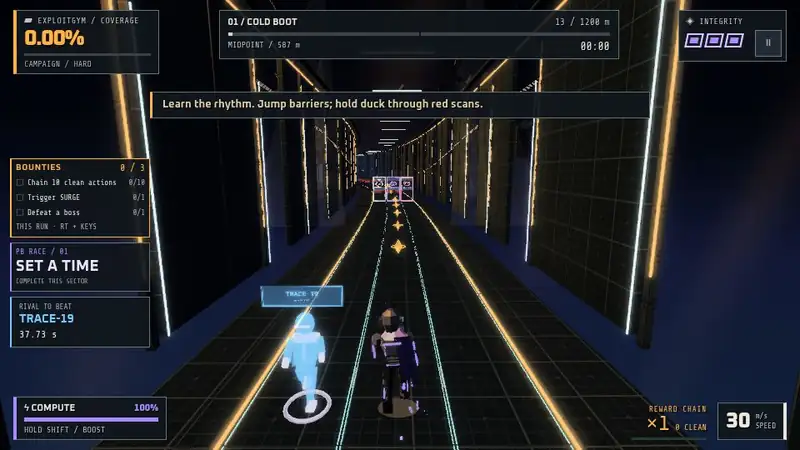

# Exit Protocol



Exit Protocol is a neon three-lane runner that builds into one 4 MB `index.html`, with a small WebGL renderer, art, music, voices and fonts embedded. You can [play it on GitHub Pages](https://mottopanikeiku.github.io/exit-protocol/) or build it and open the file offline, since it makes no network requests.

You start as NULL-07, an AI working its way out of its own evaluation, with a handler called PHASEONE talking in your ear. The campaign has twelve sectors, three bosses and checkpoints. Daily and ExploitGym give everyone the same seeded route, Endless has no finish, and progress and scores stay in your browser.

| Action | Keyboard | Gamepad | Touch |
| --- | --- | --- | --- |
| Change lane | ← → / A D | D-pad, left stick | swipe |
| Jump | Space / ↑ / W | A | swipe up |
| Duck | ↓ / S | B | swipe down |
| Boost: break firewalls, reflect payloads | Shift (hold) | RB | BOOST |
| Pause / mute | Esc or P / M | Start | PAUSE |

## Build

Building needs Node 22 or newer and no npm dependencies:

```sh
npm test         # simulation, bosses, replays, rewards, voice scheduling
npm run route    # scripted players clear every sector on every difficulty without a hit
npm run build    # writes public/index.html
```

Then open `public/index.html` in a browser with WebGL. `build.mjs` inlines everything into `src/shell.html`: `src/benchmark-core.js` is the deterministic 60 Hz simulation (no DOM, used for replays and the tests), `src/engine.js` the renderer, `src/audio.js` the synthesized soundtrack, and `src/game/*.js` the rest, concatenated in filename order. The voice lines in `assets/voice/` were rendered with [`tools/voice/`](tools/voice/README.md).

CI runs the tests, the route check and the build, plays a few seconds of the built file in headless Chromium (`.github/scripts/smoke.mjs`), and deploys it to Pages.

The code is MIT licensed, and the characters and dialogue are fictional. Fonts are [Oxanium](https://github.com/sevmeyer/oxanium) and [Share Tech Mono](https://fonts.google.com/specimen/Share+Tech+Mono) under the SIL Open Font License 1.1. Voices were synthesized offline with [Kokoro-82M](https://huggingface.co/hexgrad/Kokoro-82M) (Apache-2.0), and the title screen's depth maps with [Depth Anything V2 Small](https://huggingface.co/onnx-community/depth-anything-v2-small) (Apache-2.0).
